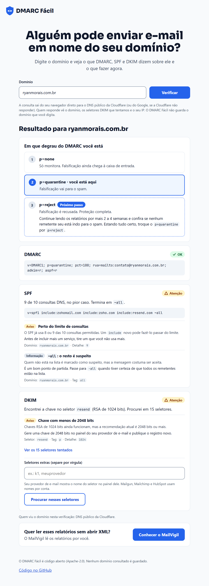

#  DMARC Fácil

**Português (Brasil)** · [English](README.en.md)


[](https://github.com/ryanvmorais/dmarc-facil/actions/workflows/ci.yml)
[](https://github.com/ryanvmorais/dmarc-facil/actions/workflows/codeql.yml)
[](https://github.com/ryanvmorais/dmarc-facil/actions/workflows/lighthouse.yml)


**O DMARC Fácil é um verificador de DMARC, SPF e DKIM que roda no navegador: você digita o domínio, ele consulta o DNS, explica cada registro em português e diz qual é o próximo passo para o seu e-mail deixar de ser falsificado.**

Quem pesquisa "verificar DMARC" ou "meu e-mail cai no spam" encontra, quase sempre, ferramentas em inglês que mostram o registro e deixam o resto por conta de quem lê. Aqui o registro vem traduzido, com o estado de cada parte e a escada do DMARC (`p=none`, `p=quarantine`, `p=reject`) mostrando em que degrau o domínio está e o que fazer para subir.

Ele é feito para donos de site, desenvolvedores e agências pequenas, no Brasil ou fora dele, e qualquer pessoa pode usá-lo de qualquer lugar: a ferramenta só consulta o DNS público. É JavaScript puro, sem build e sem dependência de runtime, e não tem servidor: a página consulta o DNS direto do seu navegador.

> **Status:** no ar em [dmarcfacil.ryanmorais.com.br](https://dmarcfacil.ryanmorais.com.br). Verifica o DMARC, o SPF e o DKIM de um domínio, e a verificação roda inteira no navegador de quem usa.

**Use agora:** [dmarcfacil.ryanmorais.com.br](https://dmarcfacil.ryanmorais.com.br). Não precisa instalar nada nem criar conta.



_A página inteira numa verificação real de `ryanmorais.com.br`, o domínio do mantenedor: o DMARC está em `p=quarantine` e o próximo passo é `p=reject`; o SPF e o DKIM têm um aviso cada._

## Como ler o resultado

A página mostra três cartões, um para cada registro (DMARC, SPF e DKIM), e a escada do DMARC. Cada cartão leva um selo com uma palavra, para que a cor não seja a única pista:


- **OK:** o registro existe e não tem nada a corrigir.
- **Atenção:** o registro funciona, mas pode ficar mais seguro ou mais claro. No DKIM, também aparece quando a chave não foi encontrada nos seletores tentados.
- **Problema:** o registro tem um erro que impede a proteção de funcionar, ou não existe.
- **Não verificado:** a consulta não terminou ou o resolvedor não respondeu.

A **escada** mostra em que degrau o seu DMARC está (`p=none`, `p=quarantine` ou `p=reject`) e marca o seguinte com a etiqueta "Próximo passo". Cada achado vem com uma frase dizendo o que significa e o que fazer.

## Privacidade e uso

- **A consulta sai do seu navegador.** O domínio vai a um resolvedor DNS-over-HTTPS público (Cloudflare ou Google), que enxerga o domínio e o seu endereço IP. Nenhum servidor do projeto recebe o que você digita, e o projeto não guarda log de domínios.
- **Só DNS público.** A ferramenta lê registros que qualquer pessoa pode consultar. Ela não escaneia, não conecta e não envia nada ao servidor do domínio verificado.
- **Sem rastreador.** A página não carrega script, fonte nem imagem de terceiros. Ela é servida pela Cloudflare, que mede o acesso apenas de forma agregada.
- **DKIM:** o seletor é escolha de quem envia o e-mail e o DNS não permite listá-los. Por isso a página procura em seletores comuns e diz "não encontrei nesses seletores", nunca "você não tem DKIM". Você também pode informar o seu seletor.

## Escopo e limitações

O DMARC Fácil é pequeno de propósito: lê o DNS e explica o que encontra. Para cada limite, o que usar no lugar.

- **Ele lê só o DNS.** Não envia e-mail nem testa se uma mensagem chega à caixa de entrada. _Em vez disso:_ use uma ferramenta de teste de entrega de e-mail.
- **Ele não lê relatórios DMARC.** Os relatórios agregados (RUA) dizem quem envia e-mail em nome do domínio. _Em vez disso:_ o [MailVigil](https://github.com/ryanvmorais/mailvigil) lê esses relatórios na sua máquina.
- **O DKIM depende do seletor.** A página só acha a chave nos seletores comuns e no que você digitar. _Em vez disso:_ veja o seletor no cabeçalho de um e-mail seu (`DKIM-Signature`, campo `s=`) e informe-o na página.
- **Ele mostra o que o resolvedor público devolveu agora.** Uma mudança recente no DNS pode demorar a aparecer por causa do cache. _Em vez disso:_ espere o TTL do registro e verifique de novo.

## O que ele faz

O DMARC Fácil é construído marco a marco, cada um desenhado antes como uma spec, em [`specs/`](specs/). Os marcos são o histórico da construção, não versões publicadas.

| Marco  | Foco                                                                                                                                            | Status   |
| ------ | ----------------------------------------------------------------------------------------------------------------------------------------------- | -------- |
| `v0.1` | Fundação: validação e normalização do domínio digitado, esqueleto sem build, testes, CI e portão de qualidade                                   | entregue |
| `v0.2` | Consulta DoH: registros TXT de um nome por DNS-over-HTTPS, com fallback entre resolvedores                                                      | entregue |
| `v0.3` | Parser DMARC: escolhe o registro entre os TXT, lê as tags e aponta os achados e o estágio na escada                                             | entregue |
| `v0.4` | Parser SPF: lê o registro, segue os `include` e o `redirect`, conta as consultas DNS e aponta os achados                                        | entregue |
| `v0.5` | DKIM: procura a chave em seletores comuns e digitados com consultas simultâneas limitadas, lê o registro, mede a chave e aponta os achados      | entregue |
| `v0.6` | Página: formulário, escada do DMARC, cartões de DMARC, SPF e DKIM com selo, textos dos achados, privacidade na tela, página 404 e Lighthouse CI | entregue |
| `v0.7` | Hospedagem: Workers Static Assets, cabeçalhos de segurança, 404 com status 404, deploy pelo GitHub Actions e conferência do que está no ar      | entregue |

## Desenvolvimento

Pré-requisitos: Node 26 ou mais novo e pnpm 12.

```bash
# Clone o repositório
git clone https://github.com/ryanvmorais/dmarc-facil.git
cd dmarc-facil

# Instale as ferramentas de desenvolvimento
pnpm install

# Ative o hook de pre-commit (uma vez por clone)
git config core.hooksPath .githooks

# Rode os testes
pnpm test
```

O portão de qualidade é o mesmo no hook e no CI:

```bash
# Confira a formatação
pnpm format:check

# Lint
pnpm lint

# Checagem de tipos do JSDoc
pnpm typecheck

# Testes
pnpm test
```

Outros comandos:

```bash
# Corrige a formatação
pnpm format

# Testes com cobertura
pnpm test:coverage

# Confere os links da lista de seletores DKIM (rede)
pnpm links:dkim

# Confere o que está no ar contra public/ (rede)
pnpm hospedagem:conferir
```

O código, os commits e a documentação técnica do repositório são em português; este README tem uma versão em inglês, o [README.en.md](README.en.md). Contribuições são bem-vindas: veja o [CONTRIBUTING.md](CONTRIBUTING.md). A stack está em [docs/stack.md](docs/stack.md); como publicar o site e desfazer um deploy, em [docs/hospedagem.md](docs/hospedagem.md); o guia para quem usa o Claude Code, em [CLAUDE.md](CLAUDE.md). Para relatar uma vulnerabilidade, veja o [SECURITY.md](SECURITY.md), nunca uma issue pública.

## Licença

[Apache-2.0](LICENSE).
